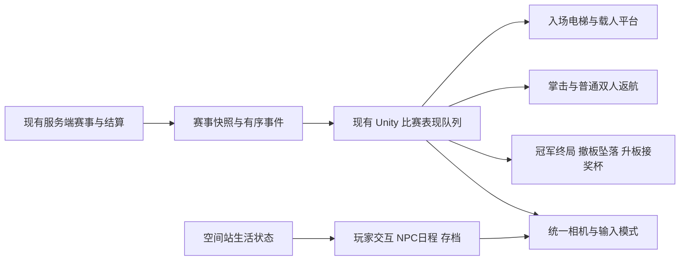

# 黑洞空间站：科幻日常与大模型竞技升级施工方案

版本：v008 · 2026-09-28 · 空间站小规模开放世界目标与施工顺序纠偏。项目暂沿用「电子蛐蛐 / 开普勒黑洞观测站」，正式命名仍未决定。

本次修订：用户明确最终是**以最初概念图的空间站为核心、包含多层多区与站外设施的连续小规模开放世界游戏**。现有 **240 × 240 m** 方形层、约 **200 m** 竞技菱形和 **72 m 外径／50 m 中孔**的环台只是已建核心区灰盒，不能再被写作完整世界边界。总览 IMG-001 v001 是最初视觉锚点，v003 是两侧功能区填充后的同一拓扑；机制图沿用 IMG-002 v005。历史 [v001](施工方案_v001.md)、[v002](施工方案_v002.md)、[v003](施工方案_v003.md)、[v004](施工方案_v004.md)、[v005](施工方案_v005.md)、[v006](施工方案_v006.md)、[v007](施工方案_v007.md) 均保留。

施工状态：独立空间站灰盒已有 240 m 外框、竞技菱形、两侧功能区、三间样板房、28 m 上部框架、104 个复用座位及赛事 HUD；现有 `ArenaConnection` 仍消费真实赛事事件。72 m 环台、扩大的地板内缘、电梯停靠点和外移的北侧观众横廊已写入独立场景；从磁盘重开的场景验证了坠落井、普通／冠军运动夹具，以及玩家房到主席位的步行和入座。放大后的正式后端赛、角色外观、全部座位视线、性能与可编辑美术源仍需复验；密封屋盖、日常交互和正式美术也未完成，不能称为可玩的升级版。默认发行场馆未切换。V14 历史包已通过外部 ZIP 的逐文件和解压启动验证，原目录清理被自动审批拦截，仍保留。

2026-09-28 后续施工：中央井口从约 32.73 m 扩至 50 m，环台外径仍为 72 m；[同机位画面、运动夹具及独立 Player 验证](施工记录/P3_中央井口50米比例复验_v001.md)已记录。东侧咖啡、两位居民日程和西侧研究台是已验证的局部切片；[单次 Player 连续漫游](施工记录/P2W_连续世界单次Player漫游_v001.md)已串联两层、三区与北侧停靠舱，但仍未形成完整的 20 分钟实际游玩与开放世界内容验收。

2026-09-28 同镜头体量轮次：依据最初 IMG-001 v001，[外方框体量研究与碰撞复验](施工记录/P3_外方框体量同镜头复验_v001.md)已将下层外环屋面、窗带和抬高的四角节点并入独立主候选场景。保存后主场景的上下层、外侧路线及中央坠落井探针通过；方框建筑感改善，但中央环在总览中仍显小，左右功能区仍缺立体层次，不能视作最终视觉比例验收。

## 1. 核心方向与本次已确认约束

把现有观战场馆扩展成一款以黑洞空间站为唯一主世界的小规模开放世界 3D 游戏。玩家能从中央竞技区自由前往居住、科研、生态、上层观景和外侧船坞等目的地，经不同高度与路线返回核心区；区域之间保留可见的空间关系和连续游玩状态。斗蛐蛐式大模型竞技仍是核心公共娱乐：平时喝咖啡、照料植物、研究模型、探索空间站，比赛时围着黑洞看模型互扇巴掌。

首个完整体验是：**从自己的舱室走出，经过观景咖啡厅，听见开赛广播，走到座位；看选手乘左右电梯入场，踏上移动平台、被运到黑洞正上方。普通对局双方正常返航；冠军决赛败者脚下的平台消失，冠军升空接奖杯。比赛结束，继续沿上层、下层或外侧路线漫游，回到有日常活动的空间站。** 这条赛事日常线是世界中的一条路线，不是游戏全部空间。

### 1.1 用户明确的硬约束

1. 俯视结构沿用用户草图：外方形生活区、内菱形竞技区、中央圆形擂台；黑洞位于整体结构下方并构成主景观。
2. 中央擂台为可升降的**环形主体**，留出直通黑洞的中央空洞；科研／设备结构不能封堵此洞。
3. 两位选手各有一块独立可出现／消失的地面。普通对局结算后两块板都保持承重并各自返航；只有冠军决赛正式结算后，败者板消失、败者原地垂直落入黑洞，冠军板保留并继续升空接奖杯。
4. 选手必须从左右电梯真实入场，不能凭空出现在中央。采用两块**可以载人移动的显隐平台**完成入口至中央的运输。
5. 旧内容清理沿用已编写的候选清单。施工前冻结当前运行版、用户未跟踪证据、依赖和回退路径；未经引用和恢复验证不直接移除。
6. 用户已确认利用原总览图左右三角区：居住侧安排公共客厅并连接角色房间，科研侧安排观测展厅／科研庭院；不再把这两块区域作为没有独立用途的贯通空洞。
7. 为每个大模型对应的独立角色规划专属房间。房间位置、面积和分批制作方式按本版建议推进灰盒验证，不把尚未建设的房间称为已完成内容。
8. 最初概念图的外方框、内菱形、中央环形结构、贯通黑洞的轴线与两侧功能区是世界识别骨架。可在这个骨架的上、下、外侧延伸可游玩空间；不能把核心区封成一间独立小场馆，也不能用远景贴图冒充可到达区域。

### 1.2 本方案提出、尚待灰盒验证的选择

| 事项 | 本版建议 | 选择理由／验证方法 |
| --- | --- | --- |
| 第一阶段运行形态 | 沿用 Windows Unity 客户端＋本地赛事后端，先做单人生活空间 | 复用现有工程；多人联机不是实现漫游的前提 |
| 漫游视角 | 第三人称为主，观景／读屏可切第一人称，保留自由镜头供摄影 | 灰盒实测窄门、楼梯、坐姿、观战遮挡后定摄像机参数 |
| 美术 | 银白功能建筑＋深灰结构；生活区暖光／织物／绿植；竞技区少量冷色导引 | 延续现有空间站识别度，同时建立日常温度 |
| 地面显隐方式 | 具实体支撑效果的固态光平台；表面和边框一起消失 | 普通金属小车的底盘会挡住下坠；显隐平台避免这一冲突 |
| 世界设定 | 科幻稳定场支撑的黑洞观测站，采用视觉尺度压缩 | 这是游戏设定，不宣称该位置具有真实轨道、辐射或潮汐可居住性 |
| 日常内容 | 第一批做舱室、咖啡、温室、熟人短对话和赛事日程，并为世界探索安排可到达的目的地 | 先形成可重复的生活循环，再逐区增加探索内容 |

“3A 游戏”在这里表达玩家期待的空间感、第三人称漫游和完整表现方向；本项目按**小规模开放世界**分期制作，不承诺成熟商业开放世界的地图面积或内容量。世界是否成立，要看多层多区之间能否连续到达、能否选择不同路线、每区是否有可辨认的景观和活动，以及远离竞技区后赛事与生活状态是否继续运行；不以单纯铺大地面或堆空房间充数。

## 2. 当前工程基线：保留什么，补上什么

只读核查基线：`main` 的 `6619de8`，当前发行 v29，加 2026-09-27 美术修复。以下是源码／现有记录核查，本轮未重新运行游戏、付费模型或测试。

| 领域 | 已存在的基础 | 本次升级工作 |
| --- | --- | --- |
| 比赛服务 | `BattleEngine` 及其 `GameCompetitions`、回合结算、对局事件、回放、生涯 | 保留权威结果与协议，适配新入退场和淘汰表现 |
| 场馆 | 黑洞、科研／裁判／解说舱、走廊、104 座、奖杯、题目屏 | 重组为空间站总体布局，审查可复用网格与材料 |
| 角色 | 标准／Q 版、自定义 GLB、展馆 NPC 漫游 | 保留角色身份与外观配置；新增玩家行动和全站日程 |
| 交通 | 双侧选手入场升降台、解说舱电梯、预定路线运输 | 复用可用动作和交互经验；中央整环升降与载人显隐平台需新做 |
| 镜头 | 自由飞行、设施点击跳转、比赛镜头 | 新增落地步行碰撞与镜头控制权切换；自由飞行不等于玩家漫游 |
| 工程分层 | Core / Infrastructure / Presentation / App / Validation 五个 asmdef、事件总线 | 在既有分层内扩展，按功能拆组件，避免再次大规模架构重写 |
| 日常 | 有 NPC 展示和设施参观 | 舱室状态、坐下喝咖啡、照料植物、短对话、跨会话保存需新增 |

当前 `game-api.ts` 已有玩家交卷接口，`game-competition.ts` 已有游戏赛事生涯和竞猜相关处理。不能按旧评估文档称其“后端不存在”。这些不作为首个生活切片新增范围，后续决定使用时先核对原生 UI 与实测闭环。

关键依据：

- [主引擎](../../arena/src/battle-engine.ts)、[赛事与判负](../../arena/src/game-competition.ts)、[客户端接口](../../arena/src/game-api.ts)。
- [赛事表现控制器](../../QuQuArena3D/Assets/Scripts/Presentation/ArenaDuelController.cs)、[双侧入场升降台](../../QuQuArena3D/Assets/Scripts/Presentation/ArenaEntranceLifts.cs)。
- [站点装配](../../QuQuArena3D/Assets/Scripts/Presentation/ArenaOrbitalNetwork.cs)、[NPC 行为](../../QuQuArena3D/Assets/Scripts/Presentation/ArenaGalleryActor.cs)、[组合根](../../QuQuArena3D/Assets/Scripts/App/ArenaBootstrap.cs)。
- [最新美术实机记录](../validation/art-repair-2026-09-27/README.md)。该记录的 RTX 5090 短段性能和离线夹具验收，不是升级后性能承诺，也不是本轮真实模型验收。

## 3. 空间结构：一眼能懂，步行能通

**最初总览 IMG-001 v001 决定外方框、内菱形、环形中心、四角节点、径向连桥和黑洞背景的整体形象；当前 v003 在同一构图内把两侧三角洞填为科研庭院与居民客厅，并标出角色居住区和坠落井。** v003 的局部剖开只为展示内部，实际需要完整顶棚与压力围护。两张图都只展示空间站核心的一个视角，没有给出全部可游玩的上层、下层及外侧设施，也没有提供可直接换算的最终米数。原错位编辑 v002 仅作历史记录。

### 3.1 平面分区

| 区域 ID | 位置与职责 | 主要场景与第一批交互 |
| --- | --- | --- |
| LOC-01 抵达大厅 | 外方北侧；新玩家入口和交通汇合点 | 到站、看导览、接收日程、前往住处／竞技区 |
| LOC-02 角色居住街区 | 外方东侧及相邻角区；安静、私密，连接 LOC-09 | 玩家舱室、每角色独立房间、门牌、床、工作台与纪念品位；首批先做玩家房间和两间角色样板房 |
| LOC-03 温室公共区 | 外方南侧；日常停留与居民相遇 | 植物照料、长椅、低成本固定短对话、观景摄影 |
| LOC-04 科研工作区 | 外方西侧与下层周边；承接已有科研功能 | 仪器观察、现有实验入口、维护小事；实验数据仍取现有后端 |
| LOC-05 菱形竞技回廊 | 四个端点接外方主通道；组织赛事人流 | 报名／开赛终端、赛程、战绩、周边展示、观众入口 |
| LOC-06 环形升降擂台 | 正中心；所有建筑围绕其空洞组织 | 双电梯入场、两块平台运送、掌击；普通对局双人返航，冠军决赛撤板与接奖杯 |
| LOC-07 观战与播报设施 | 环台外围固定结构，不能占中央井 | 固定阶梯看台、裁判舱、解说舱、大屏、外圈站立观战 |
| LOC-08 下层观测／设备区 | 围绕中央井外布置，面向黑洞 | 观测窗、维护管线、设备巡检；首版只开放一条短线路 |
| LOC-09 居民公共客厅 | 原居住侧三角留空，规划东侧；处于角色居住街区与竞技回廊之间 | 咖啡、共享座位、居民相遇、赛事转播；具有完整可走地面与围护结构 |
| LOC-10 观测展厅／科研庭院 | 原科研侧三角留空，规划西侧；连接科研工作区与竞技回廊 | 观测仪、研究展示、少量绿植和休息座椅；具有完整可走地面与围护结构 |

这里的东／西按北向朝上的规划平面定义；透视图里的屏幕左右只用于指认原留空，不作为最终世界坐标。

### 3.1.1 两侧三角区的具体安排

东侧 LOC-09 是居住街区的公共入口：从竞技回廊进入客厅，再沿安静的居住走廊拜访各角色。咖啡服务集中在这里，沿用已有咖啡厅的风格提案，不重复建设第二套同类设施。转播屏朝向公共座位，避免声音直接传入卧室。

西侧 LOC-10 是已有科研区的公共前厅：布置可观看的仪器、研究展示和带绿植的休息区，通往真正的实验／维护空间。它不另起一套科研系统，也不替代南侧温室的植物照料功能。

两区的主要面积铺设实体地板，增加顶棚／舱壁／压力窗，通过朝外或斜向下的观景窗和局部挑台看黑洞。尖角优先用于设备、储物或绿植，不强行塞进卧室和狭窄通道。保留清楚的通行主路和出入口，不用密集家具把区域填满。

新地板、支承和天花均止于中央环台与运输设施的净空边界之外，不能伸入中央坠落井、整环升降包络、左右电梯井或平台靠岸／离岸路线。灰盒阶段先检查这些动态包络，再布置室内细节。

### 3.1.2 每个角色的独立房间

房间沿外方东侧排列：房间朝外侧景观开窗，门朝内侧居住走廊；公共客厅连接走廊和竞技回廊。整体流线为「竞技回廊↔居民公共客厅↔居住走廊↔角色房间」，角色去候场时继续走既有竞技入口，不能从客厅直接穿过选手电梯或登台接驳口。

建议统一房间基础模块，先用每间约 30–40 平方米做灰盒，最终面积由家具、角色比例和摄像机通行决定。门窗、基础结构可共用，家具、灯光、收藏、工作台和奖杯陈列区分角色。卧室不承担其他区域的必经交通。

房间按稳定角色 ID 分配，不按模型 API 配置或每次模型版本更新自动增加一间；同一角色升级模型后继续使用原房间，独立新增角色再分配新房间。先交付玩家房间、两间角色样板房和一个公共客厅；长期为每个常驻独立角色逐步补齐房间。扩展优先沿外方生活环向南北延伸，空间不足再增加居住层，不占中央坠落井。

需要验证角色从住处出门、经过公共空间、前往候场的连续路线；不能一边在卧室保留同一角色实体，一边又在擂台生成另一个可见副本。比赛结束后的生活状态与赛事表现交接属于 NPC 日程衔接，不改变比赛结算。

科研站保留在空间站下部，但做成**中央让空、设备分布在周边的结构**。任何横梁、走廊、碰撞地板和整体网格合批都不得穿过下坠轴线。

### 3.1.3 小规模开放世界的空间网络

以下是下一轮灰盒的**候选施工结构**，不是已建内容，也不是用户原图里不存在的设施已获视觉批准。扩展从概念图可见的外框、四角节点、上部连桥和下部站体生长；中心的环台与黑洞井保持原比例和净空。

| 层／区域 | 连接现有核心区的方式 | 到达后的用途与识别点 | 灰盒验收 |
| --- | --- | --- | --- |
| 主层：现有 240 m 核心区 | 外方生活环、菱形竞技廊、两侧三角区 | 赛事、居住、咖啡、科研与温室入口 | 现有路线继续可走，中央井与两块平台不受扩建影响 |
| 上层：观景步道与四角节点 | 从北侧抵达大厅和东西两侧接主层，步道沿外框／径向连桥走向 | 看到完整方框、中央环台和黑洞，提供从高处辨认区域的路径 | 至少两处上下层连接，能从一侧上去、另一侧回主层 |
| 下层：环井外的观测／维护区 | 从西侧科研前厅和南侧温室边缘下行 | 透过观测窗看黑洞与设备，形成区别于主层的探索路线 | 至少两处上下层连接，所有地面和梁避开坠落轴线 |
| 外侧：有围护的接驳／船坞设施 | 由外方框的一处气闸接出，不穿过选手专用电梯 | 舰船、货物和维修活动的第一处站外可达目的地；其具体位置与造型需实景研究后冻结 | 玩家从居住区步行到设施并安全返回，赛事状态不断开 |

先验证两条不同的闭环：东侧居住区→上层观景→北侧大厅→竞技区→东侧居住区；西侧科研区→下层观测→南侧温室→西侧科研区。站外接驳设施先接一条可往返的支路。每个已开放目的地必须有至少一个可辨认的观景、互动或角色活动点；未开放通道设置可信的施工／权限边界。第三人称玩家应能读出上、下、外侧三个方向的去处。最终外延、层高、可进入房间数和步行时长由连通灰盒与实机体验确定，不用未经测试的公里数替代设计。

### 3.2 垂直层级与尺度草案

统一 `Y` 向上，`XZ` 为平面；以下只是灰模起点，先实测后冻结。

| 项目 | 灰模建议 | 必须验证 |
| --- | --- | --- |
| 已建核心区外方生活主环 | 当前外包络约 240 × 240 m；主街净宽至少 6 m | 这是核心区灰盒尺寸，不是最终可漫游世界的外包络；扩展要从外框实际连出去 |
| 菱形竞技回廊 | 四端点约距中心 100 m；对角尺度约 200 m | 四入口互通，视线不被整片墙遮断；上部 28 m 框架不封中央井 |
| 中央环台 | 当前灰盒外径约 72 m，中央孔径约 50 m | 环台占 240 m 外框约 30%；从坐姿看清空洞、双板与人物，坠落井保持连续 |
| 两块选手平台 | 每块先试 3 × 3 m，尺寸／间距随角色胶囊和掌击距离调整 | 两脚稳定、败者不借胜者板支撑、最大角色也能入场 |
| 接驳／生活主层 | Y=0 | 电梯出口、入口地坪、平台靠岸高度一致 |
| 环台演出高度 | Y=0→约 +12 m，比赛期间锁定 | 升降全程中央净空、外侧固定看台视线成立 |
| 科研／候场层 | 约 Y=-12 m，中心至少留出孔径加施工余量 | 左右电梯进出、NPC 候场、下坠探针无碰撞 |
| 新增上层、下层和外侧设施 | 先定连接点与净空，再由灰盒确定范围 | 主层到各层可往返；外侧设施有真实入口与围护；不侵占现有赛场机构 |
| 中央坠落井 | 与黑洞视觉中心同轴；整条通道连续让空 | 不用一张黑色贴图假装通道，也不以玻璃封底 |

现有局部切片从玩家／角色样板房经过居住走廊、东侧公共客厅与咖啡区，接至竞技入口和看台；玩家房经上坡到北侧交互主席位的 **334.1 m 单程**已用角色控制器验证入座／起身，旧 112.9 m 只到低位观众落脚点。候选世界另已接出上／下层步道、北侧气闸与停靠舱，并有南侧温室、东侧客厅和西侧研究台等局部行为点。[单次 Player 连续路线](../validation/station-continuous-2026-09-28/README.md)已从玩家舱绕行两层环路、三区和停靠舱后返回，实测累计 4.24 km；这不是地图直径，也尚未证明方案指定的两条独立主层闭环、真人键鼠长时间漫游和内容密度。

### 3.3 压力、重力与黑洞的视觉规则

生活区通过实体舱壁、压力窗与气闸表现可居住性；竞技区及中央平台使用空间站稳定场作为科幻设定。稳定场边界要有可见装置，不能仅靠大段说明。

黑洞远景、吸积盘和局部吞没特效分层管理：可见远景保持宏大；近场角色下落用受控轨迹和透视过渡表现进入黑洞，不按千米级真实距离做漫长自由落体。概念图的黑洞距离不作为物理参数。已有黑洞关闭选项要给竞技玩法提供低动态的暗色深井／黑洞剪影替代，撤板机制仍清楚可读。

## 4. 标志机制：左右电梯—移动平台—分支结算

本节优先级高于早期概念图。旧版“败者走向内沿／被推下去”和“中心直接出现选手”均已废弃。

### 4.1 构件职责

| 构件 | 负责什么 | 明确边界 |
| --- | --- | --- |
| 左右入场电梯 | 从候场层运两位选手到各自入口 | 两人从可见房门和电梯中进入，不在中央生成 |
| 左右固定接驳口 | 电梯出口至移动平台的短步行段 | 与生活区／看台隔离，观众不能误上选手平台 |
| A/B 两块移动平台 | 靠岸承载→运人到中央→承重比赛→按结局返航或显隐 | 每场只存在两块，不在入口保留同一块的副本 |
| 环形擂台主体 | 结构、外侧升降、灯光、围合与表演尺度 | 中央无固定柱、底盘、网格地面或隐藏碰撞板 |
| 外围固定看台 | 观众坐席、近景观看与大屏 | 不随中央环台升降；观众流线不经过坠落区 |
| 黑洞坠落通道 | 仅在冠军决赛承接败者垂直下落与最终吞没 | 不放设备或支撑梁；所有下层舱体绕行 |
| 冠军奖杯 | 决赛胜者平台上升时，从上方下降与冠军相遇 | 复用现有奖杯资源；普通对局不出场 |

平台建议采用“实体光面＋可一并消隐的边框”，由环台侧面装置导引。导引光只做侧向或空中视觉线索，**不能做成脚下的实体轨道**。若采用机械伸缩平台，必须解决托臂和底盘也撤走的问题，首版不选这条成本更高的路线。

### 4.2 一场比赛的完整表演流程

| 顺序 | 发生什么 | 完成条件 |
| --- | --- | --- |
| 1 复位 | 环台回接驳高度；两块平台出现在左右靠岸位 | 无选手站在平台生成区域；两板各有唯一身份 |
| 2 电梯抵达 | 左右电梯分别上升并打开门 | 电梯完全停止；入口可通行；选手尚在实地上 |
| 3 走上平台 | 选手从电梯走出，跨过齐平接口，站到自己的站位 | 角色足点和胶囊完全进入本平台安全区域 |
| 4 离岸运送 | 入口门关；两块平台各载一人平稳移向中央 | 角色随平台连续运动，不穿板、不滑走、不瞬移 |
| 5 靠拢锁定 | 两板停到可掌击距离，各自朝向对方 | 路径不交叉；速度归零；脚部支撑与攻击距离通过检查 |
| 6 整体升台 | 环形主体和两块平台同步到演出高度 | 高度对齐、停止；放行客户端有序回合演出 |
| 7 比赛 | 复用真实问题、掌击、裁判和比分 | 地板不随普通命中消失；保持原赛事协议 |
| 8A 普通对局结算 | 消费正式 `duel-end`；两块板保持承重 | 无撤板、坠落或奖杯；胜负仍由服务端决定 |
| 9A 双人返航 | 两块板分别载原选手回左右接驳口；两人走回各自电梯离场 | 两板均靠岸，两位选手均安全离场，才能开始下一场 |
| 8B 冠军决赛结算 | 最终对局结算后等待并消费对应 `competition-end`，核对冠军与该场两位选手 | 不能把普通单场胜利、半决赛或暂定结果当冠军演出 |
| 9B 败者撤板坠落 | 正式败者板闪烁约 0.2–0.4 秒并整体消失；败者从原脚点垂直落入中央井 | 只撤一块板，表面、边框、Collider 和承重同帧关闭；下方无底盘 |
| 10B 冠军接奖杯 | 冠军仍站在自己板上，板升空；奖杯自上方下降，两者在预定颁奖高度相遇 | 复用现有奖杯；奖杯不会砸穿角色，也不阻挡黑洞通道 |
| 11B 冠军返航 | 颁奖后冠军板回接驳高度、载冠军退回原入口，冠军走回电梯 | 败者板保持关闭直到空场复位；冠军不在高空消失 |
| 12 下一场 | 两位选手已离场后空场恢复两块板 | 赛事和表现状态一致；两板准备完成才接下一次入场 |

两条路线共用乘梯、步行、乘平台、比赛，随后分开结算并连续离场。每个阶段有可跳过的终态恢复，不要求玩家每次重看长入场。首轮完整入场目标 12–18 秒；冠军决赛败者撤板至吞没约 3–5 秒，都是待体验测试调整的目标。

现有服务端开赛后独立运行，平台就绪只解除客户端表现队列的门禁。入场期间到达的回合／终局事件有序缓存，正式场次与回放共用该逻辑，不新增“等动画结束才判题”的后端协议。平台动画不得拖延或改变后端判定。

非胜负分支同样需要闭环：待续／短暂断线时两板保持承重并停稳；确认停止、取消且没有有效 winner 时，两板分别载人返回原入口，双人乘梯离场，不吞没、不颁奖。若用户直接跳过或退出，则恢复相应安全终态。

### 4.3 只由真实冠军结算触发特殊演出

- 普通 `duel-end` 只触发两人安全返航；冠军决赛的 `duel-end` 先锁定本场两名选手与终局，再与对应 `competition-end` 核对冠军后触发唯一特殊演出。若事件顺序颠倒，按赛事 ID 缓存并配对，不能在阻塞协程中等消费队列自身。
- 冠军必须明确属于决赛两名选手，再定位另一人的平台。平台绑定稳定选手 ID，不能把“左侧”直接当败者。
- **不能用 HP=0 或普通单场 winner 撤板。** 当前双 KO 可进入加赛；加赛也可在 HP 非零时判胜。以冠军赛事正式终局为准。
- 平局、待裁定、单纯网络中断、取消和未产生冠军的异常都让两人安全返航。若超时／弃权由后端正式判出冠军，才按冠军结算演出；不能仅凭客户端计时撤板。
- 冠军演出幂等键：`competitionId + finalDuelId + championId`。重复 `duel-end`／`competition-end` 不得再次吞没或颁奖。
- 吞没只移除本场角色表现，不删除模型、API 配置、角色资源、战绩或存档。
- 重连已完成普通对局时恢复双人已返航；重连已完成冠军决赛时恢复冠军已返航、败者缺席、两板回到空场待命。服务端不提供客户端动画进度，故不补播坠落或奖杯；主动回放另建演出会话，允许再播一次。

### 4.4 玩家视线与可访问性

观战默认镜头同时交代两块板、两名角色、中央孔；撤板镜头先保留胜者作为参照，再短暂跟随败者。近景必须读得清题目、掌击和地板消失。104 座不意味着每座都能直接看清小角色；远席用大屏补足，优先打磨一组最佳座位。

玩家在咖啡厅／生活区时，比赛照常发生，可听广播和远处声音，但不被强行抢镜头。只有主动进入观战／回放模式才允许演出接管摄影机。关闭强动效时省略闪烁、震动和长下坠，直接清楚呈现撤板后的终态。

## 5. 日常循环：让玩家愿意留在空间站

第一批循环：回舱室→看当天赛程→在咖啡厅坐下／取饮品→照料一组植物或完成一次小维护→遇到居民并聊两句→观战→把比赛纪念物摆回舱室。玩家可以只漫游和看比赛，不被体力或饥饿惩罚催促。

| 功能 | 第一版可交付行为 | 验收 |
| --- | --- | --- |
| 舱室 | 开关门、坐下、调整一个纪念品展示位、床边返回／保存点 | 重启保留选择和位置；载入失败回安全点 |
| 角色房间／公共客厅 | 两间角色样板房可拜访；角色按日程在房间、公共客厅和工作／候场区移动 | 房间与角色 ID 一致，模型版本更新不丢陈设；全站同一角色只有一个可见生活／比赛实体 |
| 咖啡厅 | 入座、拿取饮品、简短饮用动作、看日程 | 椅子有占用状态，NPC 和玩家不重叠抢座 |
| 温室 | 检查、浇灌／维护一组植物、阶段性外观反馈 | 操作和进度存档；没有必要的真实时间等待门槛 |
| 居民 | 起居／工作／咖啡／观战的少量日程节点；固定短对话 | NPC 能到目的地，不穿门、不堵通道；离屏低频更新 |
| 赛事关联 | 广播开赛、今日赛程、比赛纪念物和战绩查看 | 数据来源可追溯；日常奖励与竞技排行榜隔离 |

“日常”首版不引入复杂生存、恋爱好感树、全自由建造、宇宙飞行、程序化星球、交易经济或大规模多人。它们可以进入后续提案，但不能成为完成当前主线的前提。NPC 日常不强制每句话调用大模型；未来接入对话能力时独立设调用预算和失败回退。

## 6. 主要道具与资产生产合同

道具板 01 是显隐平台的材料候选：正式版平台的边框也必须消失，不能把图中金属质感解释为永久底盘。02 为外侧升降导轨；03 报名终端；04 观景座椅；05 水培柜；06 维护机器人。

| ID | 资产 | 优先级 | 结构／交互要求 |
| --- | --- | --- | --- |
| PROP-01 | A/B 载人显隐平台，共用一个基础 Prefab 实例化两份 | P0 | 靠岸、运送、锁定、完整消隐；独立 Collider；唯一 occupantId |
| PROP-02 | 环形擂台与外侧升降模块 | P0 | 环面分段、导轨和锁止件可见；中心无碰撞封堵；看台独立 |
| PROP-03 | 左右候场电梯与接驳口 | P0 | 门、地坪、乘员点、靠岸接口；复用旧升降代码前验证新坐标 |
| PROP-04 | 观众座椅／栏杆／大屏 | P0 | 优先复用现有 104 座资源；视线和座位交互需重新验收 |
| PROP-05 | 赛事终端 | P0 | 操作复用现有赛事服务；近距离字体和手柄焦点清楚 |
| PROP-06 | 压力窗、走廊、门、墙与顶棚模块 | P0 | 统一拼接单位；可走面和装饰分离；碰撞壳保持简单 |
| PROP-07 | 咖啡吧台、饮品和座椅 | P1 | 交互挂点、手部位置、坐姿、移动通道有尺度依据 |
| PROP-08 | 玩家与角色舱室套件 | P1 | 共用基础模块，先做玩家房间＋两间不同陈设的角色样板房；稳定门牌和房间 ID |
| PROP-09 | 温室／水培柜 | P1 | 维护点、植物阶段、少量共用材质，避免透明层堆叠 |
| PROP-10 | 科研终端与观测仪 | P1 | 保留既有功能性资产，统一新空间的接口和灯光 |
| PROP-11 | 维护机器人 | P2 | 先复用已有巡检小车行为，再决定替换网格 |
| PROP-12 | 两侧三角区填充建筑模块 | P1 | 实体地板／支承／顶棚／压力窗／出入口；避开中央井及全部升降、接驳包络；室内家具复用现有套件 |

按“真实参考→草图与尺寸→灰模→Blender 源→游戏网格→碰撞／LOD→材质→Prefab→实机验收”推进。只把概念图作为视觉参考，不能把一张图当可直接导入的场景资产。

每项资产保留稳定 ID、来源、源工程、导出参数、版本、许可与哈希。建筑结构、平台接口和碰撞优先人工可控建模；生成式工具可用于已确认的静态外形候选，不把复杂升降机械与可移动承重逻辑交给生成模型猜。

现有标准／Q 版角色和自定义外观仍是角色身份来源。概念图里的两位通用人形仅是尺度及动作示意，不替换现有大模型角色设计。

## 7. 工程施工边界：复用现有分层

### 7.1 最小职责划分

- 现有后端继续决定问题、评分、胜负、生涯；生活状态不得修改竞技结果。
- `ArenaDuelPlatforms` 只管理两块板的位置／显隐／承重／乘员及演出运动。历史灰盒的 `ArenaStationGrayboxPreview` 是运动夹具；新的 `ArenaStationLiveMatch` 在独立场景经 `ArenaConnection` 接收真实服务端事件并按序演出，不决定比赛胜负。原发行场馆与 `ArenaDuelController` 的既有表现队列仍待迁移和统一，不能并行产生两个可见赛事副本。
- 升降、运输、撤板属于一个有序演出流程，不再创建第二套比赛裁判。复用已有停止、清场、重放和队列基础。
- 玩家移动、交互和空间站存档各自负责自身状态；不把全站功能继续塞入场馆构建器。交互只需最小统一入口，暂不开发通用脚本语言或大型事件编辑器。
- 继承现有 App 组合根和 Core 窄接口。在新增职责真正出现前，不为“以后可能有”增加框架和抽象层。

### 7.2 移动／承重实现重点

角色要得到平台的位移增量或稳定乘员挂点；不能随被销毁／禁用的整块平台一起消失。平台使用独立承重 Collider，人物外观独立于平台激活状态。靠岸阶段允许步行，离岸前确认角色完全入板，运输阶段约束站位。

普通对局始终保留两块板的 Renderer、Collider 和逻辑承重。仅冠军决赛撤板时同步关闭这些状态；取消脚部 IK 固定、Idle 复位或根运动回拉。下落采用受控垂直轨迹或经测试的物理运动，首版优先受控轨迹，避免随机布娃娃卡边。冠军板上升与奖杯下降应由独立展示轨迹控制，不反过来参与判胜负。

两板到中央时要同时满足：掌击可接触、脚部支撑各自独立、败者胶囊不会被胜者板托住。不得为了好看增加脚下共用隐藏 Collider。用当前标准、Q 版与最大允许自定义尺寸角色分别验证；过大模型的呈现尺度应限制在场馆可承受范围，具体继承现有缩放设置而不是凭空扩大承诺。

### 7.3 场景与保存

当前核心区仍保持可控的场景／分区；世界灰盒先在独立候选场景验证连接点，确认路线、净空和加载边界后再把生活、竞技、科研、上层、下层、外侧设施拆为加载单元。玩家在相邻区域之间保留连续行走、角色状态与赛事状态；技术上可按需加载，游玩中不通过返回主菜单或传送列表替代空间连接。比赛持久对象和事件消费者放在稳定根节点，卸载远处生活区不能把进行中的比赛断开。

新增生活存档使用显式版本号、稳定对象 ID、临时写入后替换和备份恢复。保存玩家安全位置、居住选择、角色 ID 与房间 ID 的对应关系、房间陈设、植物／日程状态和显示中的比赛 ID；不复制 API 密钥到生活存档。旧赛事、API 配置、角色自定义和生涯数据沿用既有边界。

中央平台位置不直接作为玩家普通载入点。载入时若环台不在稳定接驳状态，玩家回最近安全入口，赛事照服务端状态恢复。

## 8. 分阶段施工及交付门槛

| 阶段 | 施工包 | 可审查交付物 | 进入下一步的门槛 |
| --- | --- | --- | --- |
| P0 冻结与清理准备 | 冻结 v29 基线、依赖清单、旧版本归档索引；按清理方案处理候选 | V14 外部 ZIP 已逐文件校验并解压启动；原目录仍保留，当前版与回退链的完整恢复尚未通过 | 能从备份恢复当前版；用户原有脏文件和存档不丢失 |
| P1 最小机制灰盒 | 左右电梯＋两块载人平台＋空洞＋环台升降＋普通双人返航／冠军撤板颁奖 | 独立场景通过现有后端的 mock 模拟赛验证了 2 次普通双人返航、1 次冠军演出；真实付费模型、发行场馆和完整镜头仍待验证 | 看见完整入场与离场；普通对局零人掉落，冠军决赛仅败者掉落、冠军升板接奖杯；下方确实通透 |
| P2 核心区漫游切片 | 当前 240 m 方形主层、200 m 竞技菱形、两侧三角区、玩家步行与镜头、角色住处至看台路线 | 独立场景已有平面结构、样板房、步行控制与路径探针；正式发行包、楼梯／乘梯、屋盖和动态净空仍待完成 | 从住处经客厅到看台并返回；不占中央井或平台运送包络；不得将此阶段称为完整地图 |
| P2W 世界连通灰盒 | 在独立候选场景从原概念图骨架接出上层、下层和站外支路，建立两条可选闭环；完成第三人称步行和区域边界探针 | 可复查的世界连通图、编辑器场景、路线／净空／视线记录 | 玩家无需菜单传送完成两条跨层闭环及站外往返；任一处可返回核心区，中央井与赛事机构未受破坏；确定后才冻结世界尺寸 |
| P3 第一块完成度样板 | 东侧公共客厅的一段功能样板与咖啡区＋观景走廊＋玩家房间＋两间角色样板房＋环台主视角 | 完整材质／灯光／声音／UI 的样板区域，不要求一次精装全部三角区 | 两房共享基础模块且有角色差异；从步行与观战视角均成立，再铺量 |
| P4 日常闭环 | 房间拜访与 NPC 起居／公共空间／候场日程、咖啡／植物／纪念物、保存与载入 | 20 分钟游玩闭环和保存测试 | 房间陈设与角色对应可恢复；没有同角色同时在房间和擂台的副本；NPC 不堵路 |
| P5 开放世界逐区完成 | 按 P2W 的已验证网络逐区完成上层观景、下层观测、外侧接驳和主层剩余区域；补齐常驻角色房间与科研／播报设施 | 每区可玩版本、资产登记、目的地活动、区域切换与性能记录 | 至少两条跨层闭环和一条站外往返路线都有内容、可独立游玩并可回到赛场；各区域都有景观与行为目的；赛事在玩家远离赛场时持续 |
| P6 发行验收 | 小规模开放世界完整游玩、真实赛事接入、长时间稳定、画质档、包体整理、文档 | 可安装／启动包与完整验收报告 | 完整地图可连续漫游与返回；跨区生活／赛事状态正确；清理后重建通过；真实与夹具验证分别报告；旧版可回退 |

v001 的 46–86 人日初估只覆盖旧范围，未包含多层、站外与连续世界的施工，不能作为本版工期承诺。先完成 P2W 的连通与性能试验，再按实际可进入面积、场景装载方式、角色数量及内容密度估算 P3–P6；首批房间仍限定为玩家房间＋两间角色样板房。2–3 人协作可并行部分美术与程序，不能直接按人数等比例缩短关键路径。

每个阶段单独提交可回退版本。P2W 已在独立候选场景接出上／下层步道和北侧站外往返支路，并通过一次独立 Player 多区连续路线与站外本机赛事；继续验收方案指定的两条独立主层闭环、真人键鼠导览、同机位视觉尺度、区域边界与性能。P4 已有东侧咖啡与居民、西侧研究台、南侧温室及候选存档等局部切片，仍须组合成可连续游玩的 20 分钟日常。已接入的 HUD、大屏、104 座与角色外观保持可回归，发行启动链和 P0 可恢复归档仍须单独验收。

## 9. 测试与验收清单

### 9.1 核心机制必须通过

| 编号 | 场景 | 通过条件 |
| --- | --- | --- |
| T01 | 完整入场 | 左右选手在候场层可见，乘电梯、步行上板、乘板到中央；无凭空出现 |
| T02 | 靠岸与离岸 | 对接高度／间隙可步行；人物未完全上板时不启程；运输不滑移 |
| T03 | 两板数量 | 每个时刻最多两块选手平台，不在入口和中央各复制一套 |
| T04 | 普通对局真实结算 | 左胜、右胜、换边、加赛等普通对局均由真实 `duel-end` 结算，两板承重，双方各乘原板／原电梯返航 |
| T05 | 非终局 | 双 KO 加赛、等待裁定、未判胜异常、网络中断不误撤板；确认中止则双人安全返航 |
| T06 | 冠军决赛承重同步 | 正式冠军事件配对后，败者板消失同帧无可站立面；冠军板始终有效；两板下面无共享底板 |
| T07 | 净空 | 沿败者胶囊下坠路径做探针，穿过所有层无碰撞；无中心柱／桥面 |
| T08 | 幂等与冠军 | 普通场重复事件不坠落；冠军决赛的 `duel-end`／`competition-end` 无论顺序如何只淘汰和颁奖一次；冠军板升至奖杯下降交会高度 |
| T09 | 重连与回放 | 重连只恢复终态；主动回放新会话可完整重播；不改变赛果 |
| T10 | 跳过与退出 | 入场、运输、撤板、掉落任一时点退出／跳过后相机、板和角色状态一致 |
| T11 | 尺寸与动作 | 标准／Q 版／允许上限尺寸、自定义模型无穿板、互相托住或被 IK 拉回 |
| T12 | 升降互锁 | 整环与平台一起升降；比赛和吞没期间停稳；无相机抖动或错层 |
| T13 | 真实离场 | 普通场双方各乘原板／原电梯离场；冠军场颁奖后冠军乘原板／电梯离场；下一场独立复位 |
| T14 | 无胜者中止 | 在靠拢、作答、待续状态分别终止；两块板各载人安全返回，不吞没、不颁奖，下一场能重新入场 |

### 9.2 漫游、日常与旧功能回归

- 步行、转身、楼梯／门、乘梯／下梯、座位交互、UI 打开时输入互斥；镜头碰撞不穿墙。
- NPC 路线可达、乘梯／候场不抢占、门口不死锁；长时间运行无逐渐增多的角色副本。
- 保存／载入、损坏文件恢复、老数据兼容；舱室物品和植物状态可追溯。
- 实时赛事、旧回放、题库、裁判、模型／API 配置、解说、外观／音乐自定义、标准／Q 版继续工作。
- 玩家离开竞技区域不会终止已开始的赛事；生活区相机不被掌击和淘汰接管。
- 两侧原三角留空均有实体可走地面、围护和有效出入口；景观通过窗和挑台获得，不残留未防护的贯通洞。
- 新建筑的完整碰撞壳、支承、顶棚和家具均避开中央坠落井、环台升降、电梯及移动平台的动态包络；在环台高／低位和平台靠岸／中央位分别检查。
- 两侧新增建筑不遮挡关键看台对中央平台和掉落过程的视线；分别从最佳观战席、普通座席和公共客厅观景位置检查。
- 房间↔走廊↔公共客厅↔竞技入口／科研前厅可往返，居民不会借道选手专用接驳口；房间不是公共穿行通道。
- 两间角色样板房的 ID、门牌、陈设和住户保持一致；升级模型版本后仍保留原房间，全站生活与比赛中的同一角色不重复出现。
- 从现有主层能实际抵达上层、下层与外侧设施；两条跨层闭环和站外支路均可原路或经另一连接返回，不能仅靠摄影自由镜头或传送菜单证明漫游。
- 第三人称移动在跨层连接、气闸、室内和观景位不穿墙、不遮满角色；从远处能识别核心环台与路线节点，观景和比赛镜头互不抢控制权。
- 从站外支路返回时，玩家位置、NPC 日程、房间状态和服务端赛事均保持一致；场景加载不导致重复事件或角色副本。

### 9.3 性能与画面目标

先指定并记录真实测试硬件、分辨率、画质、人数和场景。建议把 1080p 中档 60 FPS 作为首版候选目标，在用户确定中端测试设备后冻结；4K 高档作为单独档位，不以当前 RTX 5090 短段记录担保全站。

报告平均帧率、1% low／帧时间分布、CPU/GPU 瓶颈、内存与显存峰值、加载停顿。至少覆盖：生活区移动、104 座观战、平台运送、普通双人返航、冠军坠落与颁奖、两条跨层闭环、站外往返和 30 分钟持续漫游。先调整黑洞渲染成本、透明窗层数、灯光／阴影和 NPC 更新距离，再按性能证据引入分区加载；不先引入复杂方案。

截图必须标真实 Player 分辨率。录屏只留必要长度和采样率，保留结论、关键帧和失败样本，防止再次积累几十 GiB 无索引帧序列。

## 10. 主要风险与应对

| 风险 | 影响 | 施工中的具体对策 |
| --- | --- | --- |
| 地图过大但日常单薄 | 玩家只把空间当菜单背景 | P4 前锁定一个 20 分钟循环；每个开放区至少一个可重复行为 |
| 只把核心区装修得更大 | 仍然只有一座可走动的小场馆 | P2W 先验证多层、站外、双闭环和第三人称路线，再批量精装 |
| 角色与载人平台不同步 | 滑动、穿模、人物瞬移 | P1 先用当前角色真实走流程；所有坐标和乘员状态可观测 |
| 显隐只做贴图 | 人仍站在空气上或撞底盘 | 渲染、边框、Collider 与支撑状态一同切换；胶囊探针验证 |
| 黑洞抢走全部亮度 | 看不清日常物件、题目和表情 | 生活区遮光／窗框控制，比赛人物独立轮廓光；黑洞低动态档 |
| 代码版本判断错误 | 重做已有功能或误删动态资产 | 以当前源码和运行依赖为准，旧评估只作历史资料 |
| 清理弄断启动链 | 当前版／备份／后端不可用 | 特别处理 `Backend → BuildV27/Backend` Junction；先校验再迁移 |
| 原始录像吞噬磁盘 | 工作区继续膨胀 | 每轮保存规范化证据包、原始帧外部归档，未经核查不删 |

## 11. 本轮交付和下一轮起点

当前已完成独立环台与核心区灰盒、三间样板房、玩家房至主席位的步行路线；独立场景已接入现有后端赛事包和 HUD／大屏、104 座、角色自定义外观加载链。四人模拟赛的 3 场对局带来 2 次普通返航和 1 次冠军演出，二人模拟赛的 1 次正伤害攻击对应到 1 次实际掌击接触；详情见 [赛事事件接入验证](施工记录/P1_空间站真实赛事事件接入_v001.md)。候选世界的上／下层步道、北侧接驳与东／南／西侧局部活动已有分项验证；[西侧研究台](施工记录/P4_西侧公开赛题研究台切片_v001.md)可查阅后端赛题。[单次 Player 连续路线](施工记录/P2W_连续世界单次Player漫游_v001.md)已跨越两层、三区和停靠舱，在站外等待本机赛事完赛并返回玩家舱。**方案指定的两条独立主层闭环、连续 20 分钟真人游玩、同机位视觉尺度、正式美术、现有发行场馆和真实付费模型尚未验收**。清理另见 [清理清单与执行顺序](清理清单_v001.md)及 [V14 归档验证](施工记录/P0_v14归档验证_v001.md)，真实参考及职责见 [参考依据](01_需求与参考/参考依据_v001.md)。

下一施工步：在已补厚的外方框基线上，测量中央环、内菱形和北侧抵达轴的可见比例；研究两侧功能区的可到达立体目的地，并分别复验移动平台、坠落井、看台视线与主路碰撞。随后按方案验收两条主层跨层闭环、20 分钟实际键鼠游玩和 30 分钟性能，结合结果锁定世界边界和内容密度。保留用户未提交产物；旧资产清理仍须依赖审计、可恢复归档与重建验证，已被自动审批拒绝的递归清理不得换命令绕过。
