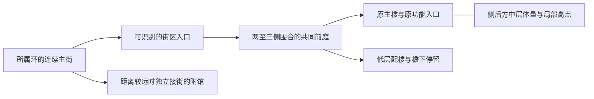

# v019 施工方案修订：街区秩序、立体层次与材料质感

**当前设计入口（2026-10-05，已提交基线 `f63dfd31`）：[三项问题整改 v007](v019/三项问题整改执行清单_v007.md)。** 以完整街区及相邻街段整改：冻结主配楼、公共空间与散件归属；显露低入口—中层主体—局部高点；旧新墙顶地及邻接甲板联合建立中深色和表面质感。补充八区差异、跨区接口和逐批退出条件。先核实已有R2未提交工作，再完成R2成对审阅，随后短住／公园、抵达／R1及全站复核；R3已完成首轮成果继续复用。此次仅更新方案，未改场景或增加验收通过项。下方各轮“当前／下一步”为历史节点；设计与顺序冲突以v007为准，施工事实仍以对应证据为准。

**R3首轮整组审阅与材料补齐已完成（2026-10-04）：** [同版本总图、283项材料覆盖及Player证据](../validation/station-v019-r3-review-20261004/README.md)。补齐七处青绿铺装和旧厅九处表面，43,348原对象、几何、碰撞与路线保持；两个近端人视可辨低厅与共享楼中层，大厅遮挡补图已完成。Win64、19张正常Player图、相位97共享楼292项／住宅组团296项／防护307项通过；380份选定构建来源核对无漂移。下一批进入R2科研—阅读、阅读—咖啡成对审阅；R3跨区辨识、完整运动与用户最终视觉认可仍待全站复核，P5未关闭。下方旧“下一步完成R3整组审阅”为历史节点。

**R3合住三户入口与共享庭院边界已施工（2026-10-04）：** [实测平面、材料归属与Player证据](../validation/station-v019-shared-boundaries-20261004/README.md)。三户入口墙和室内地面区分公共／私密范围，外门两侧加入低屏风，庭院增加一处两人停留位置。原43,322对象、墙体碰撞与居民路径保留；269个原生采样、Win64、两相位共享楼各292项／住宅组团各296项／居民各66项通过。六张正常Player图片已查看，其中大厅全景受近景居民遮挡，不能计作完整材料审阅通过。下一步完成R3整组材料覆盖、到达人视高低关系与无阻挡大厅补图，再推进R2、其余分区及P5；三项整站问题和用户视觉认可仍未关闭。下方入口边界待施工为历史记录。

**R3独立三户门庭与长檐分段已施工（2026-10-04）：** [归属、实测展开和Player证据](../validation/station-v019-homes-thresholds-20261004/README.md)。连续檐分成三段，户间打开两道约9.83m露天横向通道；八根原廊柱保留，每户以两片既有低屏风和矩形铺装划定入口过渡。43,292原对象保留；716个原生通行采样、247个檐段／开口检查、Win64和正常Player七机位通过。验证输入曾误用整环根枚举无关座位，已保持世界路线修正范围并保留失败记录；最终两相位门口／公共街边／横向通道各240项、六居民往返各66项通过。下一步为合住三户内外入口、旧厅—共享庭院停留边界及R3整组材料审阅，再推进R2、其余分区与P5；整站和最终视觉认可未完成。

**R3旧厅退让与近端到达已施工（2026-10-04）：** [平面／剖面、失败修正和Player证据](../validation/station-v019-homes-arrival-20261004/README.md)。旧厅及所属附属外退8m，两组座椅净外移4m，两份派生铺装接回入口；共享楼、六户与原居民路径保持。43,292原对象保留，两个近端人视可辨共享楼中层和上层。首轮座椅阻挡居民250m圆弧已复现并修正；最终Win64、正常Player七机位、两相位各274项共享楼／旧厅路线及各66项居民完整往返通过。下一步处理R3私密门庭、长檐分段、公共停留边界及整组材料审阅，再推进R2成对审阅与其余分区。整组视觉、完整运动周期和P5未完成；下方旧厅退让待施工属于历史节点。

**最新方案入口（2026-10-04，复核基线 `915a88f7`）：[三项问题整改 v006](v019/三项问题整改执行清单_v006.md)。** 明确八区空间结构、低中高到达人视要求、墙顶地完整材料覆盖和逐区独立验收。R3材料及柱梁／天花已装，下一步比较旧厅退让与侧向到达，连同附属件、铺装和路线整组处理；随后R2成对审阅、剩余分区与全站复核。本次仅修订方案，不增加施工或验收通过项；下方旧入口与下一步均为历史记录，有冲突以v006为准。

**R3共享楼交接与天花已修正（2026-10-04）：** [原生、Player与到达视线证据](../validation/station-v019-homes-finish-20261004/README.md)。19根窗柱顶收至白梁底并同步碰撞，190个朝下三角面使用独立低光泽天花；43,292原对象保持。Win64、正常Player六机位、相位97共享楼244项／防护307项通过。三个住宅步道位置表明旧休息厅也遮挡中层，下一批补近端到达与共同庭院平面／剖面，联合处理长檐、旧厅与共享楼关系；不得仅削长檐或继续调色。整组高度、其余分区和P5未关闭。下方柱梁／天花待修为历史节点。

**R3材料批次已安装并验证（2026-10-04）：** [覆盖表、Player画面与诊断](../validation/station-v019-homes-materials-20261004/README.md)。44处表面、5种派生材料和44个派生网格，保留43,292原对象、几何、碰撞和路线。Win64、两组正常Player共12机位及相位97门口82项／共享楼244项通过。组团高度与完整视觉未关闭；下一批先修已定位的共享楼柱梁共面交接和天花高光，再按v005推进长檐、门庭与到达剖面。下方“材料未提交／待核实”是此前节点；整站与P5仍未完成。

**最新整改入口（2026-10-04，基线 `2fe347ef`）：[三项问题整改 v005](v019/三项问题整改执行清单_v005.md)。** 以完整街区整改布局、可见高度和墙顶地材料：明确八区空间差异、长檐逐段处置、公共／私密边界、真实到达剖面及材料覆盖清单。R3收紧与阅读迁址继续复用，先核实已有未提交材料，再完成R3整组、R2成对审阅、其余分区及全站复核。暂不新增24–30m塔楼。下方各轮“当前／下一步”为历史节点，有冲突以v005为准；本轮仅修订方案，未新增施工或验收结论。

**R3六户收紧已安装（2026-10-04）：** [安装、Player画面与路线验证](../validation/station-v019-homes-group-20261004/installed-README.md)。24个对象组刚性迁位、三条居民路径前缀同步，公共连接铺装缩短；43,292原对象与六户身份保持。两个相位门口路线各82项、六居民各66项、共享楼各244项通过，公共步道84采样及正常Player六机位通过。旧白顶、长檐、墙地质感和整组高度审阅仍待完成，下一批处理常住完整材料样板；全站与P5未关闭。下方“未提交／尚未安装”是此前节点，不重复旋转迁位。

**阅读组团迁址已施工（2026-10-04）：** [实测总图、原入口对照与验证](../validation/station-v019-reading-court-relocation-20261004/README.md)。11.9m阅读楼移至共同前庭后侧，两座原低馆在前；原入口可见三层，旧址恢复连续甲板。43,292原对象、392子对象局部姿态及12座位身份保持。Win64、正常Player八机位、两相位各253项全楼／座位与各126项两馆／绕楼路线通过；首轮穿低墙的失败输入及修正保留。下一批推进R3六户与共享楼整组；全站旋转遮景、旧坐标存档和最终视觉仍未完成。下方未提交迁址及下一步迁址描述为此前节点。

**当前执行入口（2026-10-04）：[三项问题整改 v004](v019/三项问题整改执行清单_v004.md)。** 八类街区分别规定空间组织、轮廓与材料；从实际到达方向验收低中高关系，墙顶地整组修订。阅读复用已完成迁址，R3先核实已有未提交收紧工作再补整组，随后推广其余街区并全站复核。暂不新增24–30m高点；配比仅作材料选样参考。下方旧执行入口、早期高度表与“下一步”按历史节点阅读；有冲突以v004为准。本次仅更新方案，未新增施工或验收通过结论。

**旧阅读／活动馆薄顶已施工（2026-10-04）：** [剖面、两版试样与Player验证](../validation/station-v019-reading-roofs-20261004/README.md)。两馆屋顶最高点8.407→6.972m，檐底和室内保持；白色边缘配墨蓝／青绿内场，碰撞同步更新。43,292原对象保留，70个屋面射线、Win64、正常Player八机位及两相位各93项接街路线通过。原入口视锥仍不包含新阅读楼，下一步处理前庭转向及新翼接街关系，不能继续以削顶替代布局整改；随后推进R3整组。完整视觉、三项整站问题和P5仍未关闭。下方白顶待施工条目为历史节点。

**阅读背立面已施工（2026-10-04）：** [真实书架／高窗剖面、修正与Player验证](../validation/station-v019-reading-rear-20261004/README.md)。三层书架上方新增水平高窗，白色层线连接真实楼层，楼梯侧保留实体；共面闪烁已裁清，43,278原对象与全部原碰撞、座位、楼高保持。最终Win64及正常Player八机位、两相位各262项全楼路线通过。A批背面取得局部进展，下一步仍处理原入口视线与大白顶，再进入R3；三项整站问题及用户视觉认可未关闭。下方“背侧整片实墙”是施工前记录。

**当前执行入口（2026-10-04，复核基线 `128facf9`）：[三项问题整改执行清单 v002](v019/三项问题整改执行清单_v002.md)。** 本次针对布局散乱、低平和过浅补齐三项可执行要求：先冻结主楼、配楼、前庭、服务侧与散件归属；按分区组织低入口、中层楼和少量高点；将旧屋顶、墙面、檐底与甲板同批选样。阅读背面高窗已建，下一步为原到达视锥、两种白顶候选和前庭边界，之后六户常住与共享楼，再分区推广和R1／全站复核。高度区间仍为探索值，各区分别验收布局、高度、材料。已有内容不重复施工；本次只改方案，下方摘要为历史记录。

**R2阅读连续前场与墙地顶材料已施工（2026-10-04）：** [平面、原生/Player画面和验证](../validation/station-v019-reading-material-finish-20261004/README.md)。沿三座实际底层与前庭形成连续蓝色前场，旧新白墙、屋顶、墨蓝实体和木檐同步调整；43,278原对象、碰撞、身份与高度保持。Win64、正常Player八机位与两相位各93项接街环线通过。新增远景仍显示阅读后侧整片深色实墙，白顶和原主入口高度关系也未完成整组审阅；下一步先处理这些R2残项，再推进R3六户与共享楼。两版未采用试样保留，三项整站问题和P5仍未关闭。

**R2旧阅读／活动馆与连接檐已施工（2026-10-04）：** [实测组图、试装修正与验证](../validation/station-v019-reading-activity-group-20261004/README.md)。06增加厚端墙和墨蓝窗头，08保留开放门面并派生青绿基部；连接檐宽10→7m、两端各退1°，原门廊和两组支承保留。43,197原对象保持，保存后的195点檐面及支承接触检查、Win64与正常Player五机位通过；路线结果见施工记录。原到达朝向下新阅读楼主要在侧后方，本批未新增高度。继续新旧楼接街、前庭侧边、视线剖面和周边甲板，再推进R3整组；布局、高度、材料三项及P5仍未关闭。下方“下一批06/08立面”等为历史节点，不重复开工。

**当前整改入口（2026-10-04，已提交基线 `87fc5feb`）：** 三项问题继续按[第11节](v019/三项问题整改执行清单_v001.md#11-完整街段与生活组团整改)整改：先完成R2阅读—活动—新阅读楼的完整接街关系，再完成R3六户与共享楼的生活街边。已装厚端墙、活动馆基部、7m连檐及街面复用，不重复列为新工程。布局以主楼、入口、前庭、服务侧和观景留白成组；Y轴以3–5m低入口、8–14m中层、16–22m少量高点形成可见实体关系；材料把旧新墙、屋顶、檐底和甲板一起选样。各区同时改变空间组织、实体比例与材料重心，完整组团审阅通过后推广。

**本次具体施工要求：** R2优先检验环街直达新阅读楼的次入口、原06/08主入口与共享前庭的连通，边界必须接建筑转角且保留通路；用日常到达路线的平面视锥和剖面证明已有高度可见。R3按真实相邻门口划分小门庭、公共停留和共享楼到达线，先处理六户之间的空场用途与旧低屋面。白色主墙配成片墨蓝/靛蓝/青绿实体，木棕用于檐底及接触面；粗糙度、倒角、分缝与反射共同建立质感。逐区动作与完成判据见[11.6当前施工单元](v019/三项问题整改执行清单_v001.md#116-当前施工单元与交付边界)。高度区间为设计探索值，不作为未经净空、通行和视线验证的施工尺寸。

**本轮交付为方案文件。** 该次方案修订时未提交的阅读接街候选已由页首后续施工记录接续，方案修订本身不计施工成果。三项整站问题仍未关闭。第11节的当前状态和执行次序优先于下方各历史节点中的“下一步”，原实装与验证记录保留。

**R2街段材料与门前首件已安装（2026-10-04）：** [原生/Player画面、接口图与验证](../validation/station-v019-street-sample-20261004/README.md)。采用第四版，分开控制4m板缝与2m细表面；街段两端改沿整板收止，两馆真实门前加入齐平浅色面，08屋面修正UV。六个派生材质、三个派生网格，43,197原对象及全部碰撞/身份保持；正常Player五机位通过。局部路线结果见施工记录。继续两侧旧墙与连檐、周边甲板、到达人视高度和R3整组收口，不将材料首件等同完整街区或P5完成。下方两版未采用试样是此前节点。

**最新执行修订（2026-10-04，复核基线 `e0201110`）：** 针对布局散乱、Y轴层次弱、色彩过浅三项问题，按[第11节：完整街段与生活组团整改](v019/三项问题整改执行清单_v001.md#11-完整街段与生活组团整改)执行。R2样段已实测，但两版临时材料均未采用；常住共享楼已有陈设，六户整组边界仍未完成。下一步以阅读06—活动08实际街段和R3六户生活组团为两类样板，分别补齐空间边界、到达人视的高低关系、墙地顶材料及端部收口，通过整组审阅后再推广。保留已建17.88m科研与约12m中层，不强行增设高塔；本轮只更新方案，没有修改场景或新增实机通过结论。下方进度按历史节点阅读，执行次序以第11节为准。

**常住共享楼生活空间已安装（2026-10-04）：** [六户关系图、陈设、材料与验证](../validation/station-v019-homes-life-20261004/README.md)。复用原模型补10个可交互座位、5处局部柔光、2个反射区域，五块楼层饰面接入真实石材纹理；六户原身份、路线及旧休息厅保持。两相位路线各244项、防护各307项，六居民相位0日常回归66项、最终可见Player六机位通过。整组仍有旧屋面/街边衔接、墙顶质感与局部高光问题；按最新第10节继续常住整体与R2主街样段，不关闭三项总体问题或P5。下方“共享楼空房”是历史节点。

**当前方案修订（2026-10-04，已提交施工基线 `6b866b86`）：** 本次针对“散乱、低平、过浅”更新设计和交付顺序，详见[整组整改要求](v019/三项问题整改执行清单_v001.md#10-整组整改与街段样板)。以“原楼＋新增楼翼＋共同前庭＋相邻环街”为最小审阅范围；保留科研/阅读已建立面和已完成的局部遮挡、反光修整，转向完整街边关系。R3常住补六户与公共节点的完整组织，短住另作观景叠台；将R2相邻入口间的主街材料样段提前到分区推广之前，避免新楼变好而周围仍散、仍浅。以下较早摘要为历史进度，当前次序以本段和整改清单第10节为准。本轮只改方案文件，工作区未提交的场景、陈设、材质与验证不计入本轮施工成果。

| 问题 | 本次明确的执行要求 | 完成判据 |
| --- | --- | --- |
| 建筑散乱、区域相似 | 每区先冻结主入口、主楼、共同前庭、服务侧和散件归属；科研竖向实体、阅读水平厚墙、咖啡开放木檐、常住私密门前、短住公共叠台分别成组 | 同一中景包含旧新建筑及街边；隐藏标识仍能区分空间组织；所有原入口保持可达 |
| 低平、Y轴层次弱 | 延续3–5m前景、8–14m中层、16–22m局部高点的探索关系；用退台、前后错位和真实楼层显露已有高度，不统一抬高屋顶 | 从原环街到达路线能读到高低实体，剖面和开放楼层对应；公园保持低谷，黑洞与赛场视线有检查 |
| 颜色过浅、缺乏质感 | 材料样板扩大到旧墙、屋顶、檐底、院落和主街；白色主体配成片靛蓝/墨蓝/青绿/木棕，分别处理石材、瓷、金属、玻璃、木和织物 | 同配置近中远图中墙地顶不融合、深色仍有色相、表面反光与纹理尺度可辨；不靠全局压暗或增亮达标 |

**R2到达视线与阅读反光已修整（2026-10-04）：** [固定机位对照与验证](../validation/station-v019-r2-arrival-20261004/README.md)。科研外侧连接折檐开124–128°局部缺口，保留全部支柱、原门廊与旧馆屋顶；阅读入口亮点确认来自近处玻璃，派生材质平滑度0.94→0.72，未改地坪或全局照明。43,077原对象全部保留，660屋面采样、Win64与科研两相位各345项路线通过。下一施工重点为R3六户与共享楼的整组生活空间；R2大面与主街衔接、完整视觉及P5仍未关闭。

**科研/阅读成对立面已施工（2026-10-04）：** [图纸、原生对照与验证](../validation/station-v019-facades-20261004/README.md)。科研四层端部改竖向实体/窄窗，阅读三层加厚端墙并保留水平长窗与退台；楼高、原入口、楼梯及26座位保持。42,659原对象全部保留，接缝冲突已修正；Win64、两相位路线/防护通过。26座正前视野保持，阅读二层东座左偏15°局部视野收窄已记录。当前已进入原有前廊遮挡、大面质感及完整街区关系复核，R3/P5继续未完成；下方“下一批立面”与“仅文档修订”为历史节点。

**当前修订摘要（2026-10-04，施工基线`39c390b8`）：** 三项问题按“街区整体组织、可读的高低实体、墙地顶的材质层次”整改。R2局部院落边界及27处联合材料已施工，完整街区识别仍未通过；科研、阅读、咖啡重复白框玻璃的立面语言是下一批重点。已有17.88m科研、11.9m阅读、11.8m咖啡及12m常住外壳继续利用，用前后退让和实体厚度使高度在日常人视中可见。详见[本次施工修订与返修条件](v019/三项问题整改执行清单_v001.md#94-联合材料施工后的执行修订)。本轮仅更新方案，场景与既有检查状态保持。

| 本次要解决的问题 | 接下来实际改变什么 | 先完成的交付 |
| --- | --- | --- |
| 散乱、区域像同一套建筑 | 以主入口和共同前庭收拢原楼、新翼及附属件；科研竖向实体、阅读水平厚墙退台、咖啡开放檐下、常住实墙小院、短住观景叠台各有组织 | 在已有R2平面上标明服务侧、停留侧及散件去向；科研/阅读分别画正面和转角立面，标出保留、拆换、补实体的具体窗格；R3补完整组团图 |
| 低平、缺少Y轴层次 | 3–5m低入口、8–14m中层、已有16–22m局部高点形成前后递进；先改善到达方向能读到的层次 | 保留现有楼高，沿“环街—门廊—前庭”连续人视校核前檐遮挡；对照剖面标出楼板、支承、退台和可达层；24–30m高点暂不列为必建 |
| 浅、轻、材料相似 | 白色主体与中深色整面组合；先区分墙地顶明度，再分开处理粗糙度、纹理尺度、倒角及收口 | 复用已装屋面/石材/墨蓝窗台样板，补阅读地面高光诊断、端墙与窗洞近景；以两个相邻入口间的完整街段检查全站浅色大面的影响 |

**施工组织调整：** 首批改科研/阅读的具体窗墙组合，连同原楼、前庭和附属件整组审阅；咖啡以开放低檐和通透门面保持差异。科研地坪、旧顶及阅读窗台已施工，转入效果复核，不能重复当作待安装任务。随后完成R3六户与共享楼、短住与观景附馆的各自关系；相邻街区主街样段先选样再推广，公园保留开敞低谷，港区保持到达秩序。每组分别关闭布局、高度、材料三个问题，单栋楼或空房路线通过只记局部进展。

**2026-10-04首次整改清单更新（历史节点）：** 当轮沿用v019编号与既有施工成果，新增[逐区整改执行清单](v019/三项问题整改执行清单_v001.md)，确立“街区总图收口 → 低中高剖面 → 旧新楼和大面材料一起完成 → 整组验收”；单栋新楼、路线通过或加深颜色均不能关闭街区任务。当轮只改文档，未将当时未提交的咖啡候选计为验收成果；咖啡及R2后续施工以页首当前基线和施工任务为准。

2026-10-03方案基线；2026-10-04 **用户已要求按本版施工，独立候选已开始科研首件，进度见[施工任务](v019/施工任务_v001.md)**。本版回应用户指出的三个问题：建筑布局散乱、区域区分不足；建筑普遍低矮、Y轴层次少；整体色彩过浅、质感不足。v018 已用于附馆内部施工，因此本次整站设计修订使用 v019。

**设计主张：把分散单体组织成可辨认的街区，以低层入口、中层楼群、少量高点形成连续而有起伏的天际线；保留银白高科幻气质，用明确的中深色材料、真实厚度和不同反光层次建立重量感。** 工作重点从“继续增加不同造型的单栋附馆”转向“现有建筑之间的空间关系”。

**2026-10-04方案细化：** 本次进一步明确三项执行重点：先把楼与楼之间的前庭、街巷和附属件组织完整；以8–14m中层补足既有低楼与高馆之间的断层；把大面积地坪、屋面和整块立面一并纳入材料样板。科研与阅读、常住与短住分别设计，不能用相同楼体换颜色代替分区。具体补充见3.3、4.1和5.4。此处为方案要求，未据此宣称场景已达到效果。

本版是后续布局、体量与材料施工的设计依据，未完成场景实测的坐标、净距和高度均不作为已冻结施工参数。三环、既有功能、稳定身份、露天主公园及银白吸积盘继续保留。核心赛事接入与完整世界存档继续暂缓。

## 1. 现状依据与判断边界

本节1.1保留初次提案的调查基线；2026-10-04后续施工状态以[施工任务](v019/施工任务_v001.md)及整改清单为准，不再从v018重新开工。本次复核提交为`39c390b8`，包含R2测绘、局部院落边界和[联合材料施工](../validation/station-v019-material-joint-20261004/README.md)。实际查看该批科研/阅读/咖啡三张组团图和三张Player入口图，并在内置浏览器重新查看第2节两处官方建筑外观照片；最新判断见整改清单9.4。工作区已有未提交内容不计入该基线。本轮未重新测量或拍摄全站。

### 1.1 本轮实际核对

- 当前 Git 基线为 `9a465bbd`；最近一次附馆入口验证指向 `Assets/Station/Scenes/Candidates/BlackHoleStationAnnexInteriorsV018.unity`。见[四馆前庭与环街连接记录](../validation/station-v018-approaches-20261003/README.md)。后续施工从该候选的经核对快照派生，不能仅凭文件名回退到 v016。
- 实际查看了[历史整站鸟瞰](../validation/station-v015-p4-landscape-review-20261002/station-overview.png)：中外环楼群低而分散，连续浅色甲板在构图中占主导。该图早于四馆及露天公园，**只能说明当时的总体问题，不能冒充最新全站现状**。
- 实际查看了 2026-10-03 的 [B02 玩家人视](../validation/station-v018-approaches-20261003/render-visible/b02-approach.png)和 [B04 玩家人视](../validation/station-v018-approaches-20261003/render-visible/b04-approach.png)：两馆已有明显竖向体量与深色局部，但其周围仍是横向低楼、大面积浅色地面；入口彩带能指路，尚不足以形成街区空间。
- 核对[v016 四馆方案及实测记录](施工方案_v016_建筑多样化提案.md)、[v018 内部施工](v018/附馆内部施工_v001.md)和[v017 无屋顶修订](v017/无屋顶修订_v002.md)。B02 高度记录约18.11m、上部阅览廊位于6.23m；B04高度约14.89m，已有可达舱室和部分露台。它们不是全部只有一层的白盒，不应为了拔高重做已有可用空间。
- 工作区有前置字体、v016候选、B03玻璃及资源等未提交内容。本轮只更新方案和入口文档，不将这些内容纳入本轮提交或宣称为本版成果。

### 1.2 三个问题对应的设计缺口

| 用户问题 | 从已查看证据可支持的判断 | 本版处理 | 验收时应能看到什么 |
| --- | --- | --- | --- |
| 散乱、分区不明显 | 单栋轮廓已有变化，但楼群之间主要靠空地和彩带连接；共同前庭、主次入口和街道边界不够连贯 | 先划街区包络、归属与主次建筑，再组织院落、建筑边线和步行入口 | 鸟瞰能圈出街区；人视能认出入口与主楼；散件都有归属 |
| 普遍矮、Y轴层次少 | 单个高馆与周围低楼之间缺少中层过渡；屋顶与入口多呈同一水平展开 | 增加有实际空间厚度的中层楼翼、退台与高低组合，保留低层前景 | 看到入口—中层—主楼的前后叠合；高处有真实可达空间或明确封闭用途 |
| 过浅、缺乏质感 | 大面积浅地与白墙明度接近；深色主要停留在细框、核心和少量家具 | 建立白色、区域中深色、自然材料和金属的面积关系；分别修正表面、反射与收口 | 白色仍清楚，但体块可分；蓝绿不发灰；瓷、金属、玻璃、木与织物可辨 |

以上是设计诊断，不是对当前Shader或曝光的故障定论。本轮未重拍全站、未测全体楼高，也未重新进行Unity运行验证。

## 2. 真实参考与方案取舍

### 2.1 已实际查看的真实建筑

2026-10-03 使用内置浏览器查看设计方官方页面及照片，无外部 computer-use。

| 参考 | 本轮实际看到的内容 | 本项目采用的方法 | 不直接照搬的内容 |
| --- | --- | --- | --- |
| [Habitat 67 · Safdie Architects](https://www.safdiearchitects.com/projects/habitat-67) | 临水总体照片中，退台体块聚合成几个有主峰的组团，连续低层连接其间，上层错位留出空隙 | 生活区的“低入口—中层叠庭—局部高点”，让多栋读成一组；竖向交通成为组团的一部分 | 裸混凝土色、巨大密度、住宅数量和屋顶种植；照片不是可分发游戏资产 |
| [Norwegian National Opera and Ballet · Snøhetta](https://www.snohetta.com/projects/norwegian-national-opera-and-ballet) | 官方临水外观照片中，白色斜面与深色玻璃带、高起实体之间有清楚的前后和明暗关系 | 白色主体通过凹入玻璃、斜面与实体高度变化获得厚度；公园边界保持低而开敞 | 复制大面积白色广场、整站斜坡屋顶或真实建筑平面；本轮未以该页验证室内材料 |

这些观察支持空间组织方法，不证明下面建议的米制尺寸、配色比例或技术参数。四馆原始参考、来源与生成关系继续见[v016参考记录](v016/meshy-architecture-concepts/references.md)；本轮未向生成服务上传参考照片，未购买或生成资产。

### 2.2 选择的路径

| 路径 | 收益与代价 | 决定 |
| --- | --- | --- |
| 仅加深颜色、抬高少数屋顶 | 成本低，但散乱布局和中层体量缺口仍在 | 只作为材料样板，不作为整站解法 |
| **按现有功能重组街区，补中层体量，分区建立材料层次** | 能同时解决三个问题，复用四馆与原有楼群；需要重新验证包络、视线和局部路线 | **本版采用** |
| 全站高密度高层化、连续连体巨构 | 竖向变化强，但容易遮挡黑洞、压住赛场、挤占露天公园并破坏旧功能 | 不采用 |

## 3. 总图与归属：三环不变，街区成为设计单位

沿用[三环米制总图](v015/layout-review-v004/README.md)：主盘直径508m；R1半径25–84m，F-A为84–92m，R2为92–176m，F-B为176–184m，R3为184–254m。固定抵达组在外缘，不增加第四主环。R1/R3顺时针、R2逆时针，固定换乘带与运动环平齐衔接。

**街区边界以所属环的局部坐标和既有根节点表达。** 不把瞬时世界东南西北当作永久分区；跨环视觉轴线只能作随时间变化的景观，不能作为唯一导航依据。

### 3.1 分区设计表

下表的区名是规划标签，不新增房间、居民、交互或存档ID。原R2三组公共功能不合并删减；常住与短住继续区分。

| 街区 / 归属 | 原对象与附馆关系 | 建筑群组织 | 远景轮廓 / 玩家近景识别 | 材料重心 |
| --- | --- | --- | --- | --- |
| 赛事核心 / R1 | 原圆形梯级看台、环廊、赛事设施与贯通井 | 保持连续圆形主体；入口附属件从属环廊，不再散成小亭群 | 全站中心环形地标，真实梯级与放射楼梯可读 | 瓷白、银色结构、深海蓝座席与凹入部位 |
| 会客生活街区 / R2 | 原咖啡、阅览会客、观景廊；B01为同环附馆 | 原主楼与配楼围出面向环街的共同前庭；曲壳为副地标，低入口后有中层背景 | 横向连续、局部曲壳抬起；入口内凹、木色接触面与蓝色织物 | 珍珠白、胡桃棕、明确中蓝、少量黑色框体 |
| 科研共享街区 / R2 | 原科研馆、共享工作、档案设备及状态台 | 较紧凑的院落式组团；原主馆后侧或侧后方试摆中层楼翼，设备附属于本组 | 竖向窗肋、较整齐的大面、深入口，组内设一个主高点 | 瓷白、靛蓝、黑色核心、拉丝银 |
| 研修阅读街区 / R2 | 原研修和阅读活动；B02在实测西侧阅读亭旁 | 用连续阅读前庭和低侧翼承接B02，保留原阅读设施；不因名称“档案”强行迁B02到科研馆 | 折面高点、低位阅读湾与台阶式侧翼，形成安静内院 | 白色、墨蓝、局部木色与柔和织物 |
| 常住街区 / R3 | 原六户常住、共用廊檐与公共入口 | 以现有生活组团为基础形成院落；低层原户在前，中层共享体量在侧后，公共穿行不穿住户 | 退台、实墙与窗的节奏、低门廊；避免酒店式整排同高门头 | 珍珠白、暖棕、局部深青绿、黑色窗套 |
| 短住观景街区 / R3 | 原八套短住、公共起居；B04为共享休憩附馆 | 原短住与B04形成主次关系，用共同前庭和现有支路连接；不同于常住的私密小院 | 较清晰的中层叠台与观景露台，主楼退后、低层入口面向环街 | 珍珠白、较深的青绿、木棕、局部银色 |
| 生态公园 / R3 | 露天主园、六株作物和照料对象；B03为独立主题副馆 | 主园保持连贯开敞绿量，B03以现有环街联系，园外不铺散树木 | 树冠、水岸、低池壁构成独特轮廓，避免再用高楼或大罩界定公园 | 植物真实深浅绿、深青池壁、木质触面、少量白色边界 |
| 固定抵达组 / 港区 | 原07/09功能、船坞及到达路线 | 候舱与服务空间形成明确到达前庭；设施归队，不散落到主环 | 长向候舱＋一个入口体量，视线直接找到换乘路线 | 瓷白、深蓝、黑色基座、克制银色引导 |

### 3.2 收拢规则

1. **每组先定一个主入口、一个主要公共空间、一栋主建筑。** 配楼、廊檐、状态台、座椅和照明围绕它们组织；主入口是识别重点，不关闭原有可用次入口。
2. **共同前庭必须有可读的两至三侧边界。** 优先用现有建筑转角、侧翼、低墙和檐下空间形成；面向环街的一侧开放，不围成封闭广场。不能只把地面涂成另一种颜色。
3. **主环街—街区入口—前庭—建筑门口形成连续层级。** 通行地面保持连续实铺，不为划区挖沟或开井。分缝、材质分区与建筑边线对应，不增加无归属彩带。
4. **先收拢可调整的附属件，再处理净空中缺少的建筑体量。** 原楼保持可见、可达，不套壳遮住旧楼；功能对象不因“显乱”被删除或变成纯装饰。需迁位时保留原对象及ID、记录旧新变换与路线变更。
5. **B01与原咖啡、B03与主园不可假定相邻。** 历史中心距离分别约77m、100m，只能当调查线索；先复核完整包络及实际路径。无法形成同一前庭时，采用“主区＋沿同环街联系的副馆”，不硬拉长廊穿过别区、不填满两者之间空地。
6. **每个散件必须登记归属。** 记录场景对象路径、稳定ID（若有）、运动父级、功能、完整包络、保留/迁位/派生处理、受影响路线。真正无功能的历史装饰也先列清单，再在候选处理，原版本保留。
7. 组间留清楚的横向街巷与观景缺口；相邻组团不用同样的门架、立柱和家具排布反复套版。统一收口规格，不统一整站轮廓。

空间关系示意（非坐标图；各组分别在自己的运动环内成立）：

### 3.3 分区差异必须落实到空间与立面

沿用第2节已实际查看的真实建筑参考，以下是针对本站功能的设计转译，不是供应商现成资产或已施工成果。每区以一种主要立面节奏为主，家具、铺装和灯具服从该区建筑关系：

| 街区 | 主要空间与轮廓 | 立面和近景识别 | 与相邻功能的区别 |
| --- | --- | --- | --- |
| 科研共享 | 较紧凑的院落；低翼与较高主翼形成主次 | 竖向窗肋、成片靛蓝内衬、清楚的银色收口 | 强调竖向与规整，不向其他街区复制四层框架 |
| 研修阅读 | 06研修馆与新阅读楼组织自己的前庭；B02与西侧阅读亭为另一节点，沿环街联系 | 水平窗带、较厚白色端墙、木质侧屏；高层退后，前侧留阅读露台 | 以横向层线与实体厚度区别科研的竖肋；B02保留独立高点身份，不用连廊强行并院 |
| 咖啡会客 | 向环街开放的共同前庭；低入口衔接后侧中层楼翼 | 内凹门面、木质檐底、中蓝织物与较连续的透明界面 | 比阅读区更开放；曲壳仅作已有副地标，不给所有楼加壳 |
| 常住 | 保留原户及私密门前空间；共享体量位于侧后，公共穿行绕开户门 | 实墙、凹窗、暖棕接触面与少量深青；低门廊形成生活尺度 | 窗与实墙节奏重于连续玻璃带，不做酒店式同高门头 |
| 短住观景 | 公共到达前庭衔接B04；后部叠台面向观景方向 | 较连续的青绿立面、退台阴影、银色栏板与观景窗 | 公共性和露台层次更强，不复刻常住私密小院 |
| 公园 / 港区 | 公园以水岸、树冠和低边界组织；港区以长向候舱和清楚到达入口组织 | 公园采用自然绿量、深池壁和木触面；港区采用深蓝入口内衬、白色候舱和银色导向 | 两区分别以自然开敞与到达秩序识别，不为统一楼高补楼 |

**每区的最小交付单位是一整组空间。** 至少包含原主楼与新体量的关系、一个共同前庭、接入主街的入口、附属件归属和同一组地面/屋面/立面材料。没有可用净空时，先靠旧楼收边、局部材料与附属件整理建立边界，再决定是否补楼；不把空地全部填满。只完成一栋新楼不能计为该街区完成。

**R2实测补充（2026-10-04）：** [当前施工图与归属](../validation/station-v019-r2-layout-20261004/README.md)确认B02到06研修馆根节点100.06m、到西侧阅读亭33.00m；B01到咖啡主包77.33m。功能归属可相同，院落仍按实际相邻关系分别组织；这些直线距离不是净距或步行距离。

## 4. Y轴层次：增加可读体量与真实空间

### 4.1 高度梯度

以下高度均以**所属环局部完成地面为0**，是本版白盒探索区间，非当前实测、结构论证或最终批准尺寸。既有高于/低于该值的建筑不直接拉伸。冠部装饰不计为可使用楼层。

| 层级 | 建议探索高度 | 作用与分布 |
| --- | --- | --- |
| 人尺度前景 | 3–5m | 原低层门廊、入口侧翼、檐下与街边配楼；保留近景亲和尺度 |
| 街区中层主体 | 8–14m | 多层楼翼、阶梯式配楼或有真实厚度的复合体量；成为楼群的主要过渡层，避免只有一座高馆 |
| 街区主楼 / 次级高点 | 16–22m | B01/B02/B04既有高度关系优先复用，科研与生活组团形成有主次的峰值；不要求每区都顶到上限 |
| 全站少量高点 | 24–30m，首轮最多两处 | 优先在R2科研组与R3短住组的侧后方探索；只有包络、支承、功能、视线与性能均成立才保留，可取消 |

R1保持中心地位依靠环形整体尺度与视线组织，不为了高于所有新楼无限拔高。禁止做绕全环等高连续墙，也不把所有低楼升到同一高度。

**当前施工优先级：先补8–14m中层，再评估额外高点。** 已有科研17.88m主翼及B02等高馆继续承担峰值；24–30m仅保留为有条件探索，不列入当前必建数量。一个组团应先在同一人视中读出低入口、中层背景和局部高点；观察方向应沿用既有到达路线，不能为凑三层构图另选不常用机位。新高度造成既有重要观景持续受挡时，先后退、分段或取消，不用增加更多高楼来平衡天际线。

### 4.2 分区实施方式

- **R2科研 / 阅读优先形成中层楼群。** 以原科研主馆为主体，在净空允许的侧后方试摆有完整楼层厚度的楼翼；B02先通过低侧翼、前庭边线与深色材料承接周边，不直接把18m原馆拉高。若需新增上层使用空间，限定为原有阅读/共享停留用途。
- **R2会客保持横向舒展，但不全组低平。** B01高帆作为已有起伏，原主楼侧后方安排中层背景；临街仍保留低入口和可见原咖啡。曲壳不成为全区每栋的统一帽子。
- **R3常住与短住采用退台。** 原住户和门口关系保留；优先在配楼侧后形成8–14m台阶体量，用B04已有错层作局部主景，再决定是否需要更高楼翼。新增共享空间不凭空增加居民、房号或存档承诺。
- **公园是天际线中的低谷。** 主园不恢复屋顶、玻璃罩、拱架或入口大顶盖，不用周边高墙封闭天空；植物与B03现有轮廓提供层次。公园内不为增加Y轴层次造高塔。
- **抵达组以清楚入口和候舱主次为主。** 不为凑统一高度建设港区高楼，不改变固定/运动归属。

### 4.3 必须有“楼层”，不能只高一张皮

首轮至少做成一处新增中层可达停留面，并与原地面路线连续；可优先选科研组阅读夹层或短住共享观景层。选址在P1实测后确定，只做一处首件，不同时开多个竖向系统。

每个拟开放层先出剖面，标明层高、地板厚度、楼梯落点、门洞、净高、护栏、转身平台与回到地面的路线；复用已经可用的楼梯和交互实现。保留门、家具及角色比例，不整体缩放楼体及其内部来制造高度。不能到达的体量必须明确封闭且不展示误导玩家的开放门、座椅或行走露台。

较高体量优先放在组团侧后，低处朝向主街、赛场与重要观景方向。新楼翼、悬挑、护栏、楼梯和阴影影响均纳入完整包络；支承不能跨运动接缝，二层廊桥只可在同一环的同一建筑组内研究，首件不以廊桥为必要条件。

### 4.4 视线与空间检查

施工前固定主抵达、咖啡观景、阅读停留、常住入口、短住露台、公园水岸六类观察点，并记录原相机与看向黑洞/赛场的方向。既有看得到的关键景物作为保护线索，不能先遮挡再改取景角度。

每个拟高点至少核对近、中、远三档构图；用原生玩家视高与鸟瞰分别看入口、中层和高点是否形成递进。对运动关系做包络/视线角度扫描，找最不利相位，再进行连续动态漫游；只测相位0和97不能证明所有相位成立。对短暂遮挡允许在方案审阅中逐项取舍，但持续封住原主要观景方向时先减高、退让或取消体量。

**2026-10-04施工反馈：此关口尚未通过。** 7点双环相位初筛与原生对照确认科研新增楼、常住拟建楼分别影响原黑洞/赛场方向；1°几何取样端点跨度约17.07/8.87分钟，不按“短暂遮挡”放行。咖啡改为4.2m低前翼及后退的14m主翼后有所改善，仍待细化验收。四区净空通过不等于观景通过；先返修上述体量，再推广正式建筑。原图、失败候选、修订尺寸和方法边界见[观景关口记录](../validation/station-v019-views-20261004/README.md)。

后续施工已把科研新增组侧后退(-6,0,-20)m，保留四层及原功能；原眼点黑洞中心在1°取样中不再受该楼遮挡，Player路线、防护和可见渲染已重验。常住v005保留14m上部共享体，以两端交通体承托并让中部通透，仍待正式细化。该修订推进了观景问题处理，未关闭整站观景审阅，详见[退让实装记录](../validation/station-v019-retreat-20261004/README.md)。

**阅读街区施工反馈（2026-10-04）：** 原三层阅读组经1°细查发现公园原眼点看赛场中心有约1.40分钟取样端点跨度的遮挡。侧窗和数值减高均未解决，实装改为沿原研修包局部X内退14m，保留0/3.6/7.2m三层及11.9m总高；四个相关眼点细扫均不再命中赛场中心，仍有最多1/5边缘射线受挡。原馆窗台墙与地面纳入同组材料，两段庭院铺装衔接旧门与新楼，西侧实体改为有窗台/窗楣保护的横向窗带。后续分区应优先核对完整体量位置、入口联系与实际窗洞，不能靠一律降矮处理遮挡。此为本区实装反馈，整站观景和最终视觉仍需审阅，见[阅读旧新衔接与退让记录](../validation/station-v019-reading-court-20261004/README.md)。

## 5. 色彩与材料：白色保留，增加有份量的中深色

### 5.1 面积关系与分区差异

将旧版“各处浅蓝浅绿点缀”的执行倾向修订为：**白色是主体材料之一，各街区有成片中深色构件和明确的材料配比**。浅蓝/浅绿仍可局部使用，不再给全站相同的大浅色底。

以下为每区代表性外观镜头中**人工设计的可见表面**的配色起点，排除天空、植物和水面；不按像素黑白统计把阴影算成黑材质，允许样板评审后调整。银色单列，避免同一表面重复计数。

| 区域 | 白色瓷面/浅色实体 | 区域中深色材料 | 棕色/木色 | 银色金属 | 综合色彩感受 |
| --- | ---: | ---: | ---: | ---: | --- |
| R1与固定港区 | 60% | 30% | 0% | 10% | 银白主导，深蓝/黑色形成清楚的实体凹口与层线 |
| R2咖啡会客 | 50% | 25% | 20% | 5% | 中蓝与棕色成片出现，生活氛围更温和 |
| R2科研 | 50% | 35% | 5% | 10% | 成片靛蓝与竖向银色收口，白色轮廓清楚 |
| R2研修阅读 | 50% | 30% | 15% | 5% | 墨蓝水平窗带、白色实体端墙与木质侧屏 |
| R3常住 | 50% | 20% | 25% | 5% | 暖棕与实墙凹窗为主，深青作为较少的整块内衬 |
| R3短住 | 50% | 30% | 15% | 5% | 青绿立面与白色叠台为主，木色集中公共触面 |
| 公园人工构件 | 35% | 30% | 30% | 5% | 白色退为边界与框体，深池壁和木触面衬托自然绿量 |

数字是设计目标，不是本轮对现状面积的测量。不要把所有材料调黑来硬凑比例：优先选入口内衬、整块侧墙、竖向交通核、檐底和院落地坪分区。深色必须与结构/功能对应，不能随机棋盘式染色。黑色主要用于较小基座、窗框与核心；不使用大面积工业灰作为替代底色。

建议先比较中蓝、靛蓝、深青绿、胡桃棕四组色样；在锁定的中性光与局部暖白下选取，最终基色由真实材质样板确定。白色可有瓷白与珍珠白差异，但不能让地面、墙、窗套、家具全部共享同一种平滑度。

### 5.2 质感的施工动作

| 材料 | 需要做的工作 | 失败表现 |
| --- | --- | --- |
| 白色瓷面 | 有板厚、倒角、克制分缝，稳定的中等宽度高光；墙与地面分开派生材质 | 大面积纯白无层次，或把白色阴影误判为灰色材质后继续增亮 |
| 中深色烤漆/釉面 | 有清楚色相、局部可见反射；用于完整体块或内衬 | 纯色漫反射平板、颜色靠灯光染出，背光全部堵死 |
| 银色金属 | 窄而清楚的边缘反射、适当方向性纹理；保留原始金属色 | 用灰色漫反射板冒充金属，或全表面镜面导致刺眼 |
| 玻璃 | 保留实厚、独立框体、内外可读性和与环境一致的反射；核对法线与透明叠层 | 只看到黑框、玻璃变成不透明蓝墙，或把地球天空倒影烘进贴图 |
| 木色与织物 | 木纹尺度/方向服从真实构件，接触面与檐底用途明确；织物以柔和反射区别于瓷面 | 整块棕色塑料、全站木纹同向、椅垫和金属同样发亮 |
| 地面 | 连续实铺；主街、院落和门前有不同但相关的色深与微表面，跟随建筑边线 | 全站白地一片，或用细密拼花制造视觉噪声；通道被深色材质读成空洞 |

材质实装前检查现有合法PBR资源和原始供应商预览；不足时再查免费成熟资源，记录来源、许可与尺寸。此轮真实建筑照片只用于观察，不能直接当纹理或生成输入。Meshy仅在确有独特建筑网格缺口时使用，不用新增模型替代材质与布局整理；保留任务及实际费用，不自动购买积分。

### 5.3 光照与材料分开验证

继续采用v017中性柔光、局部暖白，冷白/冰蓝只作有限功能强调。银白吸积盘保持，不整站偏黄、不用全局高饱和滤镜补材料颜色。

每个样板先锁定相机、曝光、白平衡、环境、灯和URP RendererIndex/后处理/抗锯齿；分别比较“几何变化”“基色与微表面变化”“必要的局部灯光变化”。相机复制必须包含URP AdditionalCameraData。反射在正常可见Player与当前旋转位置核对，历史隐藏取景失败不得代替当前材质诊断。

### 5.4 大面积表面和旧新衔接必须一起处理

本次复看[科研退让原生鸟瞰](../validation/station-v019-retreat-20261004/overview-trial-v001/research-overview.png)：科研新楼已有深色与高度变化，但画面中浅色甲板、低屋面仍占较大范围。该图只支持这个机位的视觉判断，不是全站面积测量，也不能单凭它认定曝光异常。

因此每个街区的材料施工至少覆盖以下三类关系，不能只给新楼加深窗框：

1. **地面与墙分开。** 公共环街保持连续和可读；前庭使用与该区中深色相联系的中等明度瓷面，门前保留较浅过渡。铺装边线跟随院落和建筑，不再增添孤立彩带；深面不可被误读为空洞。
2. **旧屋面与新增楼翼有主次。** 保留旧屋面形态，通过檐底、边框、收口及微表面差异建立厚度；大白面允许保留，但应能读出面转折和宽窄高光，不能所有屋面、甲板、墙都使用同样的光滑白材质。
3. **深色成面，纹理有尺度。** 靛蓝、墨蓝、青绿用于完整内衬、墙段或层带；木纹遵循构件方向，金属与瓷面分别调反射。先比较真实PBR样板，再决定纹理强度，不用全局压暗、加曝光或染色灯光代替。

每区提交一组固定机位近/中/远图：近景检查构件厚度和材料，中景同时包含原楼、前庭及新增部分，远景检查与相邻区的区别。另提供隐藏文字标识的图供审阅；若中景仍只读到一栋孤立新楼，或各区只能靠色相区分，回到布局/立面修订，不继续堆装饰。

## 6. 施工顺序与明确交付

**当前执行补充：** P0已建立，科研、阅读、咖啡及常住生活空间已有局部成果，保留并补验，不重做已通过且未受影响的内容。按[整改v003第5节](v019/三项问题整改执行清单_v003.md#5-施工顺序与停止返工的条件)，先核对阅读接街／迁址候选与共同前庭，再完成六户常住整组，随后推广至其余分区；布局、到达人视高度和墙地顶材料分别验收。暂不新增24–30m高点。以下P0–P5为完整流程，历史起点不等于本轮重启指令。

以下为已获授权的施工顺序；进行中状态另记[施工任务](v019/施工任务_v001.md)，不将本表的通过条件改写成已有成果。每阶段记录技术检查、视觉审阅与用户认可三种状态，不能相互替代。

| 阶段 | 工作和交付 | 通过条件 / 不通过时处理 |
| --- | --- | --- |
| P0 现状冻结 | 从当前v018候选核对并派生v019；保存源场景哈希、前置dirty边界、最新全站鸟瞰及六类人视；形成原对象/稳定ID清单 | 当前施工基线可恢复，图像与场景一致；不误用v015历史鸟瞰当施工前图 |
| P1 街区总图与归属 | 逐组实测包络、门、家具、通路；输出同环局部坐标总图、保留/迁位/补建表、组团边界、主次建筑与散件归属；确定首件地块 | 每个对象有去处、原门可达；主环街与固定带连续；新体量不侵占公园/原住户/其它组团；净空不足先减量 |
| P2 整站体量白盒 | 同时检查整站低中高关系，但只用可撤销体量；提供各环展开立面、首件剖面、鸟瞰和六类人视，进行运动包络与观景检查 | 每个建筑街区有可读主次和中层过渡；公园保持低谷；没有连续等高墙，未拉伸旧楼或家具 |
| P3 首个街区样板 | 优先选科研共享组，制作完整前庭、原主楼与中层楼翼关系、至少一处新增可达高位停留面；同一组同时完成白/深蓝/银色/局部木色材料样板 | 原功能与上下层路线可用；关闭标识与色彩提示仍能靠体量和空间认出分区；各材料近中远可辨，原观景保留 |
| P4 分区推广 | 先研修阅读与咖啡会客，再常住/短住，最后公园边界与港区；每区调整自己的轮廓和配比 | 不是复制科研模板；不散种植物、不恢复主园顶盖；新旧楼形成一组，旧楼仍可见可达 |
| P5 集成复核 | 更新同机位图、两相位已有路线回归及最不利相位检查，连续动态跨缝/上下层漫游、身份与存档语义检查、Win64构建及正常Player性能对照 | 变化范围内检查通过，视觉问题清单逐项关闭；硬件、分辨率、质量和未覆盖范围明确，不能只凭构建宣布完成 |

P1若证明科研组无可用包络，则先选短住组作同等范围样板，并在总图记录原因；不能默默侵占公园或移走原功能来坚持首件选址。高点、楼翼数量由包络和空间效果决定，不以堆资产作为进度。

## 7. 三项问题的最终验收表

| 项目 | 必须提交的证据 | 视觉判据 |
| --- | --- | --- |
| 布局与分区 | 有归属编号的最新总图；每区鸟瞰＋主入口人视；原对象去向表；实际到达路线 | 主楼、共同空间与入口一眼可定位；区间有清楚空隙与街巷；关掉名字/图标仍能凭轮廓、空间和材料区分各区 |
| Y轴层次 | 各环展开立面；首件剖面及上下层连续实走；六类观察点与不利相位对照 | 低中高递进分布在楼群，而非只有孤立高馆；退台有厚度、有支承；观景不被持续封闭；公园天空敞开 |
| 色彩与质感 | 锁定相机的前后图；各区材料样板近景；正常Player反射及运动观察 | 白墙与地面不融合；中深色成片但不过黑；瓷、银、玻璃、木、织物区别明显；不过曝、无塑料感和明显透明排序错误 |
| 既有使用与性能 | 稳定ID/原门/座位/照料对象核对；受影响路线与原回归；同硬件同设置帧时间、绘制量、透明/阴影开销对照 | 原功能可达，开放上层可上下；未开放部分不误导玩家；新增体量的性能代价在施工基线冻结的预算内 |

可补做盲识别审阅：用随机顺序的各区人视图隐藏文字标识，记录审阅者实际辨认与混淆的区域；不捏造受试者或识别率。用临时无色材质检查空间与高低关系，但不保存覆盖正式材料；材料再单独核对，避免颜色掩盖空间问题。

## 8. 与历史方案的关系及本轮交付边界

- v015继续管理三环、步行、圆形看台和身份保护；v019更新街区组织、中层体量与色彩质感方向。
- v016四馆、源模型、原建筑与既有内部保留。后续不再以“新增四种不同轮廓”作为全站分区完成条件。
- v017中性柔光/局部暖白及主园露天修订继续有效；旧文中“只用冷白”“主园必须玻璃罩内”均不是本轮限制。
- v018已建立的内部、座位、B02窗外视线和四馆入口连接属于保护基线；若受新布局影响必须明确重新验证，不以历史通过结果直接覆盖新版本。
- 2026-10-03方案修订轮新增本方案，并同步项目导航与方案入口。该轮未修改Unity场景、材质、模型、相机、灯光或运行代码；Meshy调用0次，新增Meshy消费0积分；未运行Unity构建、行走或性能测试。2026-10-04起的候选施工、检查与未完项另见施工任务，不能将本条历史边界当作当前工程状态。
- 本轮检查限于文档链接、数值/方向一致性、历史版本关系、Git差异及提交范围。新增高度、配比和首件选择是待实测落地的设计提案，尚非实机效果或最终视觉认可。
